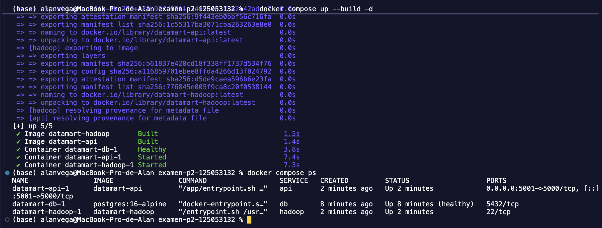
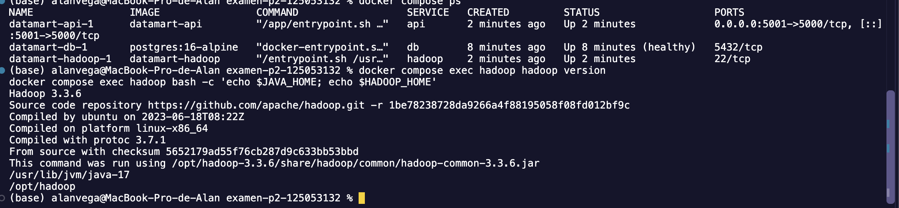
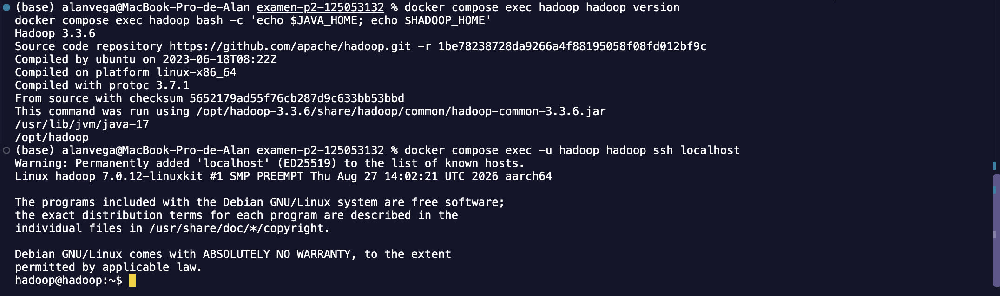
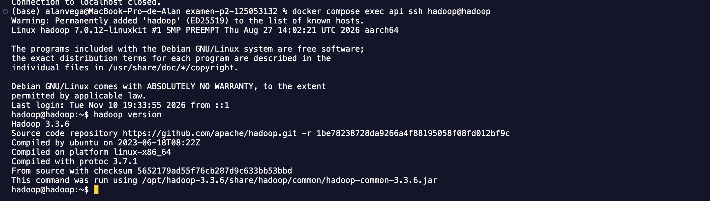
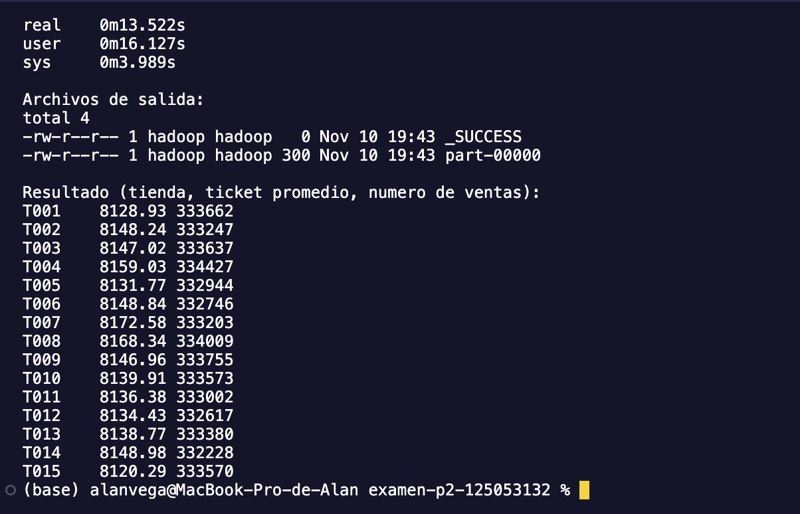
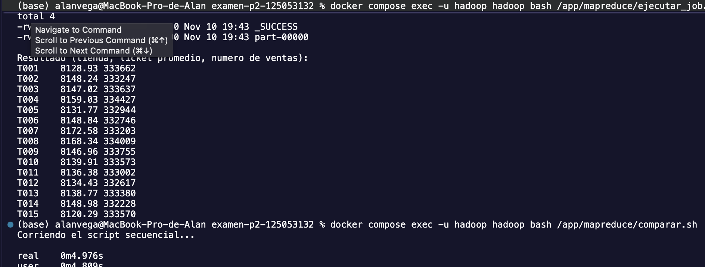
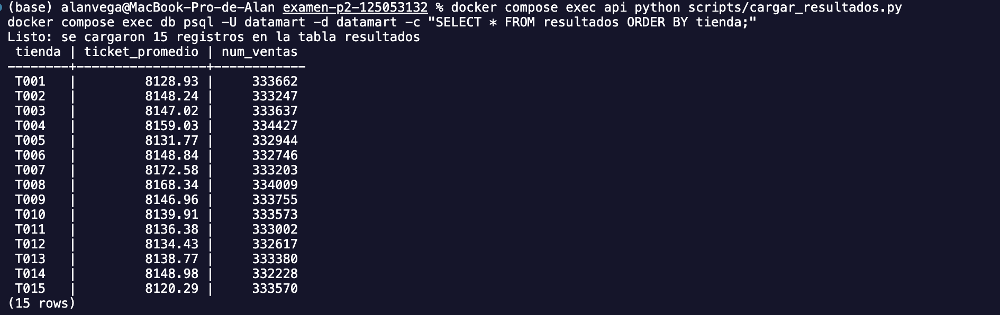
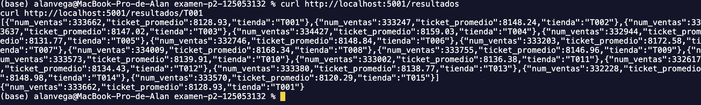
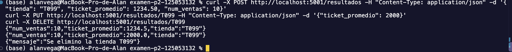
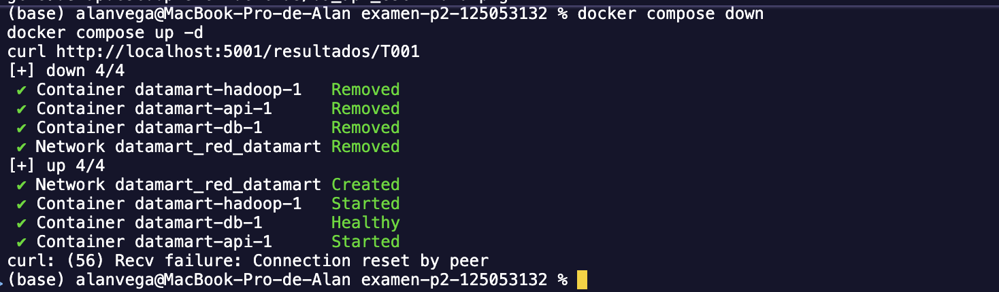

# Examen del segundo parcial: Pipeline de datos con Docker

**Materia:** Manejo Masivo de Datos  
**Alumno:** Alan Noé Vega Nieto  
**Matrícula:** 125053132  
**Tema:** Ticket promedio por tienda 

## ¿Qué hice en este proyecto?

Primero genero un archivo CSV con las ventas. Después, Hadoop procesa esos datos con `mapper.py` y `reducer.py`. El resultado se guarda en PostgreSQL con un script de Python y, al final, puedo consultar o modificar los registros desde la API de Flask.

El proyecto usa 3 contenedores:

- **hadoop:** tiene Debian 12, Java 17, Python 3 y Hadoop 3.3.6. Aquí se hace el cálculo con MapReduce en modo standalone.
- **db:** usa PostgreSQL 16 para guardar los resultados en la tabla `resultados`.
- **api:** tiene Flask, los endpoints del CRUD y el script que carga los resultados a la base de datos.

Los contenedores se comunican por la red `red_datamart`. La base conserva su información en el volumen `pgdata`.

## Cómo correr el proyecto

Se necesita tener Docker Desktop abierto, todos los comandos se ejecutan desde la terminal.

### 1. Entrar a la carpeta del proyecto

Primero se clona el repositorio:

```bash
git clone https://github.com/alan67-bsk/examen-p2-125053132.git
cd examen-p2-125053132
```

### 2. Generar el archivo de ventas

El CSV no está incluido en el repositorio porque pesa aproximadamente 340 MB. Lo genero usando mi matrícula:

```bash
cd data
python3 ../generar_dataset.py 125053132
cd ..
```

Esto deja el archivo `ventas_125053132.csv` en la carpeta `data/`, que después utiliza el contenedor de Hadoop.

### 3. Preparar las variables de entorno

Creo el archivo `.env` a partir del ejemplo:

```bash
cp .env.example .env
```

Después abro `.env` y cambio la contraseña de ejemplo por la que voy a utilizar.

### 4. Levantar los contenedores

```bash
docker compose up --build
```

La primera vez puede tardar más porque tiene que descargar e instalar las dependencias, incluyendo Hadoop.

Cuando los contenedores ya estén funcionando, dejo esa terminal abierta y uso otra para los siguientes comandos.

### 5. Ejecutar MapReduce

```bash
docker compose exec -u hadoop hadoop bash /app/mapreduce/ejecutar_job.sh
```

Con esto se procesa el CSV y se calcula el ticket promedio de cada tienda.

El script también elimina una salida anterior para que Hadoop pueda volver a generar el resultado y mide cuánto tarda.

La parte principal que ejecuta Hadoop Streaming es esta:

```bash
hadoop jar $HADOOP_HOME/share/hadoop/tools/lib/hadoop-streaming-*.jar \
  -input /data/input/ventas_125053132.csv \
  -output /data/output/resultado \
  -mapper mapper.py -reducer reducer.py \
  -file mapper.py -file reducer.py
```

Este último bloque no hace falta ejecutarlo aparte, porque ya está incluido en `ejecutar_job.sh`.

### 6. Comparar los tiempos

```bash
docker compose exec -u hadoop hadoop bash /app/mapreduce/comparar.sh
```

Este comando ejecuta la versión secuencial de Python para compararla con Hadoop. También comprueba que los resultados coincidan.

### 7. Guardar los resultados en PostgreSQL

```bash
docker compose exec api python scripts/cargar_resultados.py
```

El script toma la salida de MapReduce (`part-00000`) y la guarda en la tabla `resultados` de la base de datos.

### 8. Probar la API

Para consultar todos los resultados o buscar una tienda en particular:

```bash
curl http://localhost:5001/resultados
curl http://localhost:5001/resultados/T001
```

## Evidencias del examen

### Parte A. Infraestructura

Aquí se ve que los tres contenedores están levantados:

```bash
docker compose ps
```



También comprobé la versión de Hadoop con:

```bash
docker compose exec hadoop hadoop version
```



### Parte B. Conexión SSH sin contraseña

Configuré el acceso por llaves SSH, sin usar contraseñas. Las llaves se crean al iniciar los contenedores, así que no tuve que guardarlas en el repositorio.

Primero probé la conexión dentro del propio contenedor de Hadoop:

```bash
docker compose exec -u hadoop hadoop ssh localhost
```



Después probé la conexión desde el contenedor de la API hacia Hadoop:

```bash
docker compose exec api ssh hadoop@hadoop
```



En esta segunda conexión, la llave privada se queda en `api` y la pública se comparte por el volumen `llaves_ssh`, para que Hadoop permita el acceso.

### Parte C. MapReduce y comparación

El `mapper.py` lee cada venta, toma la tienda y calcula el ingreso multiplicando la cantidad por el precio unitario. También omite el encabezado y los registros que no tienen el formato esperado.

Después, `reducer.py` junta las ventas de cada tienda, suma sus ingresos y los divide entre la cantidad de registros. Así se obtiene el ticket promedio de cada una.



Para saber si realmente convenía usar Hadoop, comparé su tiempo con el de un script normal de Python.



### Resultados de la comparación

| Método | Tiempo real |
| --- | --- |
| Hadoop MapReduce (standalone) | 13.522 segundos |
| Python secuencial | 4.976 segundos |

En mi prueba, Python secuencial fue más rápido, ya que terminó 8.546 segundos antes que Hadoop.

Esto pasa porque Hadoop necesita preparar el trabajo y ordenar los datos antes de terminar el cálculo. Como aquí lo usé en modo standalone, todo se ejecutó en una sola máquina.

En cambio, el script de Python solo leyó el CSV y fue sumando los datos de cada tienda, sin esos pasos extra.

Lo que pude observar es que Hadoop no siempre será más rápido, porque depende de la cantidad de datos y de cómo esté configurado.

En este caso, el script secuencial fue aproximadamente 2.7 veces más rápido.

También comprobé que los dos métodos entregan el mismo resultado. El script `comparar.sh` lo revisa usando `diff`.

### Parte D. Base de datos y API

Primero cargué los resultados de Hadoop a PostgreSQL:



Luego probé las consultas GET:

```bash
curl http://localhost:5001/resultados
curl http://localhost:5001/resultados/T001
```



También probé que se pudiera agregar, modificar y eliminar un registro.

**Agregar una tienda (POST):**

```bash
curl -X POST http://localhost:5001/resultados \
  -H "Content-Type: application/json" \
  -d '{"tienda": "T099", "ticket_promedio": 1234.50, "num_ventas": 10}'
```

**Modificar el ticket promedio (PUT):**

```bash
curl -X PUT http://localhost:5001/resultados/T099 \
  -H "Content-Type: application/json" \
  -d '{"ticket_promedio": 2000}'
```

**Eliminar esa tienda (DELETE):**

```bash
curl -X DELETE http://localhost:5001/resultados/T099
```



Por último, revisé la persistencia de los datos.

Al apagar los contenedores con:

```bash
docker compose down
```

Y volverlos a levantar con:

```bash
docker compose up -d
```

Los registros siguen guardados porque PostgreSQL utiliza el volumen `pgdata`.



## Parte E. Preguntas de teoría

### 1. ¿Cuáles son los modos de Hadoop?

**Standalone:** todo se ejecuta en una sola máquina y usa sus archivos locales. Es el modo que utilicé para procesar los datos de este examen.

**Pseudo-distribuido:** también usa una sola máquina, pero separa los servicios de Hadoop en distintos procesos, como si fuera un clúster pequeño. Puede utilizar HDFS y necesita la comunicación entre esos servicios.

**Totalmente distribuido:** trabaja con varias máquinas conectadas. Así puede repartir las tareas y almacenar los datos de forma distribuida.

### 2. ¿Por qué monté el CSV como volumen y no usé COPY?

Porque el CSV es bastante pesado y no necesitaba meterlo directamente en la imagen de Docker.

Al montarlo como volumen puedo cambiar el archivo sin reconstruir la imagen. Además, los datos quedan separados del código y se puede usar el mismo proyecto con otro dataset.

### 3. ¿Qué diferencia hay entre docker compose down y docker compose down -v?

Con `docker compose down` se eliminan los contenedores y la red, pero se conservan los volúmenes nombrados.

Por eso los resultados de PostgreSQL siguen ahí cuando vuelvo a levantar el proyecto.

En cambio, con `docker compose down -v` también se eliminan los volúmenes.

Si hago eso, pierdo los datos guardados en `pgdata` y tendría que cargarlos otra vez.

### 4. ¿Por qué MapReduce no siempre es más rápido?

Porque necesita preparar las tareas, organizar los datos y juntar los resultados. Todo eso también consume tiempo.

En este examen, como estoy usando Hadoop en una sola máquina, ese trabajo extra hizo que tardara más que Python secuencial.

MapReduce tiene más sentido cuando hay una cantidad mucho mayor de datos y varias máquinas que puedan repartirse el trabajo.

### 5. ¿Cuál es la diferencia entre CMD, ENTRYPOINT, COPY y ADD?

**CMD y ENTRYPOINT:**

Los dos sirven para indicar qué se ejecuta al iniciar un contenedor.

`CMD` establece un comando o unos argumentos por defecto que se pueden reemplazar al ejecutar el contenedor.

`ENTRYPOINT` define el programa principal que se va a ejecutar.

En el Dockerfile de Hadoop usé `ENTRYPOINT` para preparar las llaves y `CMD` para iniciar SSH.

**COPY y ADD:**

Ambos permiten agregar archivos a una imagen.

`COPY` se usa para copiarlos directamente.

`ADD` tiene opciones extra, como extraer archivos `.tar` locales o descargar archivos desde una URL.

Para copiar archivos normales es suficiente con `COPY`.

## Archivos del proyecto

```text
examen-p2-125053132/
├── README.md
├── .gitignore
├── .env.example
├── docker-compose.yml
├── generar_dataset.py
├── data/
├── hadoop/
│   ├── Dockerfile
│   └── entrypoint.sh
├── mapreduce/
│   ├── mapper.py
│   ├── reducer.py
│   ├── secuencial.py
│   ├── ejecutar_job.sh
│   └── comparar.sh
├── api/
│   ├── Dockerfile
│   ├── entrypoint.sh
│   ├── requirements.txt
│   └── app.py
├── scripts/
│   └── cargar_resultados.py
└── evidencias/
```

La carpeta `data/` es donde genero el CSV, pero ese archivo no se sube al repositorio.

En `evidencias/` guardé las capturas de las pruebas.

## Si aparece algún error

**Error: `env file .env not found`**

Significa que me faltó crear el archivo `.env`. Lo puedo solucionar con:

```bash
cp .env.example .env
```

**Error: `No encuentro /data/input/ventas_125053132.csv`**

Significa que el archivo de ventas no se generó o no quedó dentro de la carpeta `data/`.

**El puerto 5001 está ocupado**

Puedo cambiar `API_PORT` en `.env` y volver a levantar los contenedores con:

```bash
docker compose up -d
```
